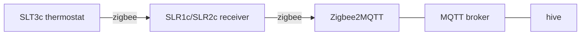

# hive

> Unofficial: not affiliated with or endorsed by Hive or Centrica. Hive is a trademark of its owner.

One-shot CLI for a Hive thermostat. Talks to the Hive receiver through [Zigbee2MQTT](https://www.zigbee2mqtt.io/) over MQTT. No Hive account, cloud or hub.



The SLT3c is only a remote control. `hive` controls the receiver. Heating only: the SLR2c hot water channel is not supported.

## Commands

```
hive status         Heating:   manual, target 21°C, room 19.4°C, boiler on
hive manual 21      hold 21°C until told otherwise
hive off            off; frost protection still applies
hive schedule       follow the thermostat schedule (also ends a boost)
hive boost 1h [22]  boost (default 18°C); 30, 45m, 1h30m...; max 6h
hive dashboard      live TUI: temperature and humidity of every sensor, boiler on/idle/off, batteries
```

- Flags: `--broker` (`HIVE_BROKER`, default `tcp://localhost:1883`, `mqtts://` for TLS), `--username` (`HIVE_USERNAME`), `--password` (`HIVE_PASSWORD`).
- Exactly one receiver must be paired with Zigbee2MQTT (base topic `zigbee2mqtt`).
- Exit status is 0 once the receiver confirms the change, 130 if interrupted, 1 on any other error.

## Install

```sh
make install
```

## Setup

1. Get a Zigbee USB coordinator [supported by Zigbee2MQTT](https://www.zigbee2mqtt.io/guide/adapters/). Keep it off USB 3 ports.
2. Install an MQTT broker (`apt install mosquitto`) and [Zigbee2MQTT](https://www.zigbee2mqtt.io/guide/installation/).
3. Unplug the Hive hub, then pair the receiver and thermostat following the [Zigbee2MQTT SLT3C instructions](https://www.zigbee2mqtt.io/devices/SLT3C.html). The Hive app stops working for these devices.

## Scheduling

To run a heating schedule on the Pi, see [deploy/systemd](deploy/systemd).

## Notes

- Hive encodes modes in `system_mode` plus `temperature_setpoint_hold`, which the generic Zigbee2MQTT climate entity doesn't handle. `hive` sends the payloads used by [HA-Hive-Local-Thermostat](https://github.com/andrew-codechimp/HA-Hive-Local-Thermostat).
- `status` takes ~2 s: it reads each attribute from the receiver instead of trusting cached values.
- The thermostat schedule can't be edited through Zigbee2MQTT.
