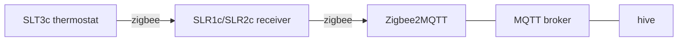
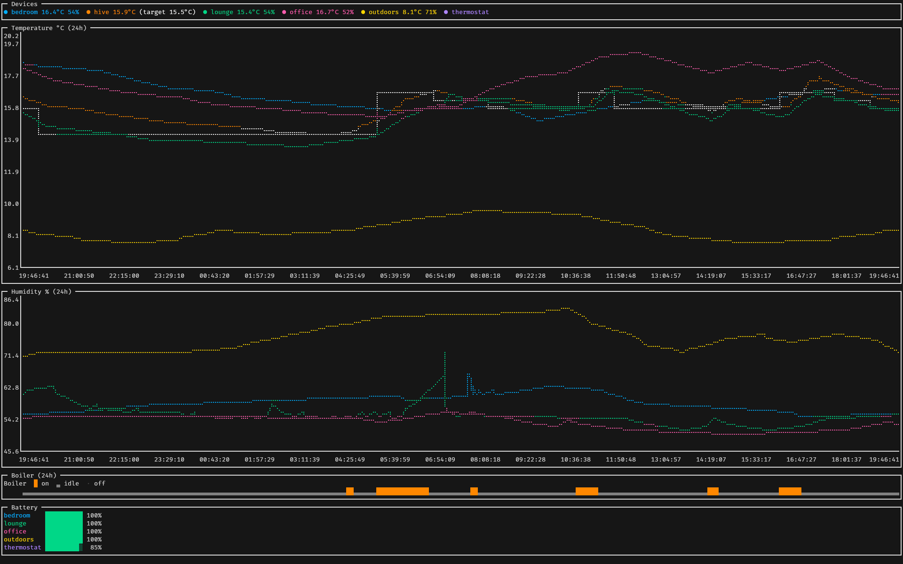

# hive

> Unofficial: not affiliated with or endorsed by Hive or Centrica. Hive is a trademark of its owner.

One-shot CLI for a Hive thermostat. Talks to the Hive receiver through [Zigbee2MQTT](https://www.zigbee2mqtt.io/) over MQTT. No Hive account, cloud or hub.



The SLT3c is only a remote control. `hive` controls the receiver. Heating only: the SLR2c hot water channel is not supported.



## Commands

```
hive status         Heating:   manual, target 21°C, room 19.4°C, boiler on
hive manual 21      hold 21°C until told otherwise
hive off            off; frost protection still applies
hive schedule       follow the thermostat schedule (also ends a boost)
hive boost 1h [22]  boost (default 18°C); 30, 45m, 1h30m...; max 6h
hive dashboard      live TUI: temperature and humidity of every sensor, boiler on/idle/off, batteries
hive record         record the dashboard's history to disk until stopped (30 days)
hive summary [first [last]]  mean/min/max per sensor, spread between rooms and boiler use for a day or range of days (default today)
```

- Dashboard keys: `w`/`W` time window, `1`-`8` show or hide a device on the charts, `o` show or hide the outdoor sensor, which starts hidden (`--outdoors`, default `outdoors`), `space` pause, `?` help, `q` quit.
- `record`, `dashboard` and `summary` share `--history` (`HIVE_HISTORY`, default `~/.local/state/hive`). The dashboard loads everything `record` wrote, then goes live.
- `record` also stores the gas used from an Octopus smart meter as the `gas` metric (kWh per half hour) when `OCTOPUS_API_KEY`, `--octopus-gas-mprn` and `--octopus-gas-serial` are set, and likewise the electricity used as the `electricity` metric with `--octopus-electricity-mpan` and `--octopus-electricity-serial`. The dashboard draws a line for each on a "Usage" chart of the last 7 days, whatever the window; Octopus publishes about a day late, so the line stops short of the right edge and the chart says how far behind it is. It reads the history at start and on `w`, not live.
- Flags: `--broker` (`HIVE_BROKER`, default `tcp://localhost:1883`, `mqtts://` for TLS), `--username` (`HIVE_USERNAME`), `--password` (`HIVE_PASSWORD`).
- Exactly one receiver must be paired with Zigbee2MQTT (base topic `zigbee2mqtt`).
- Exit status is 0 once the receiver confirms the change, 130 if interrupted, 1 on any other error.

Example `hive summary` output:

```
2026-10-23  until 20:43

            mean   min   max
bedroom     15.9  14.8  17.2
hive        15.6  14.0  17.5
lounge      15.0  13.2  16.6
office      16.9  15.1  18.9
outdoors     8.2   7.3   9.3

spread 2.4°C mean · 3.9°C max
boiler 3h16m on · 6 runs
```

## Install

Needs Go 1.27+. Installs `hive` to `$GOBIN` (default `$GOPATH/bin`).

```sh
make install
```

Shell completion: `hive completion <bash|zsh|fish|powershell>`.

## Setup

1. Get a Zigbee USB coordinator [supported by Zigbee2MQTT](https://www.zigbee2mqtt.io/guide/adapters/). Keep it off USB 3 ports.
2. Install an MQTT broker (`apt install mosquitto`) and [Zigbee2MQTT](https://www.zigbee2mqtt.io/guide/installation/).
3. Unplug the Hive hub, then pair the receiver and thermostat following the [Zigbee2MQTT SLT3C instructions](https://www.zigbee2mqtt.io/devices/SLT3C.html). The Hive app stops working for these devices.

## Scheduling

To run a heating schedule and the history recorder on the Pi, see [deploy/systemd](deploy/systemd).

## Notes

- Hive encodes modes in `system_mode` plus `temperature_setpoint_hold`, which the generic Zigbee2MQTT climate entity doesn't handle. `hive` sends the payloads used by [HA-Hive-Local-Thermostat](https://github.com/andrew-codechimp/HA-Hive-Local-Thermostat).
- `status` takes ~2 s: it reads each attribute from the receiver instead of trusting cached values.
- The thermostat schedule can't be edited through Zigbee2MQTT.
